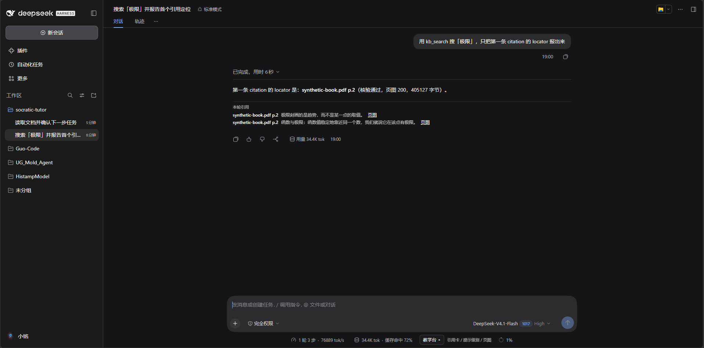
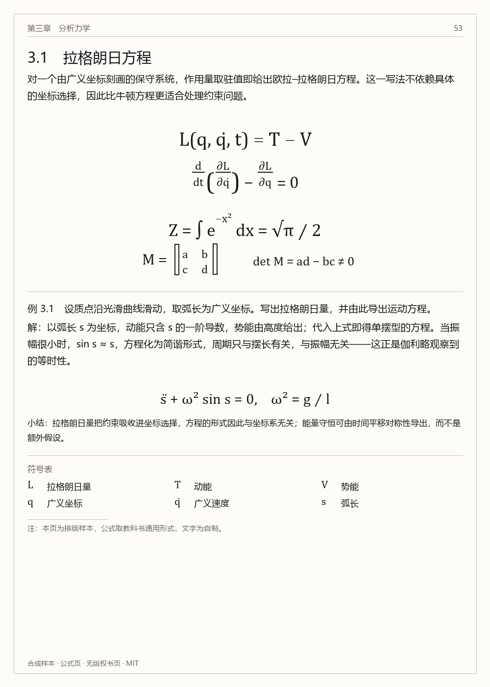
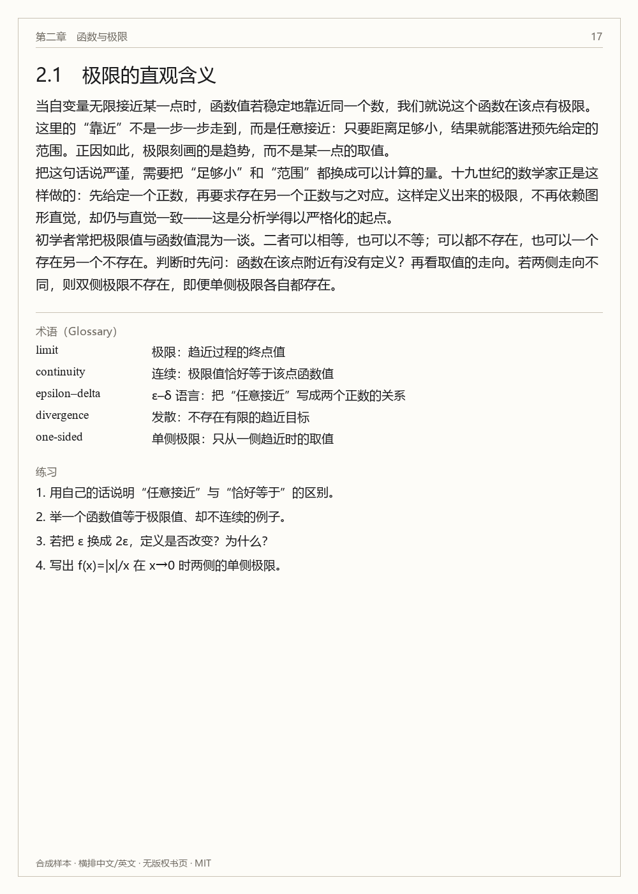
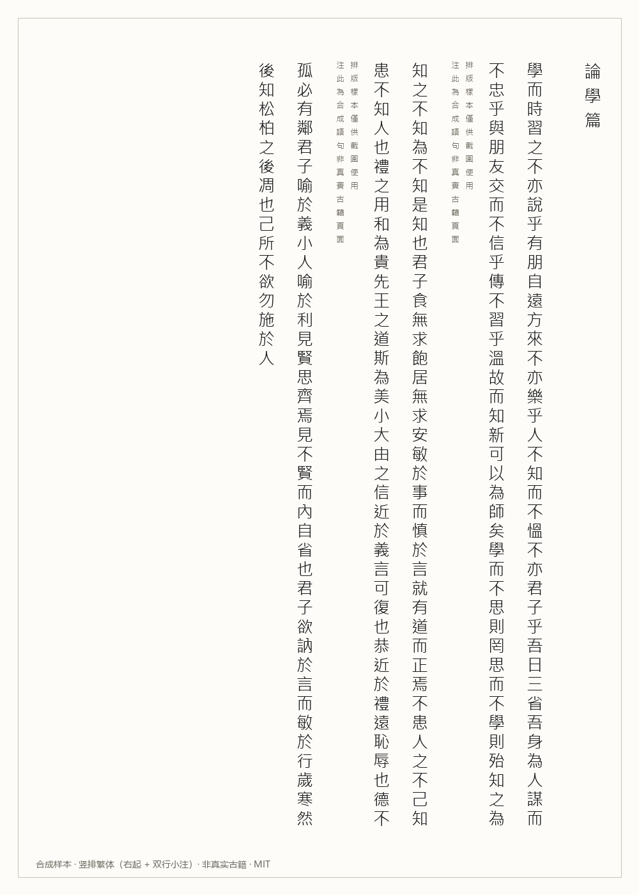
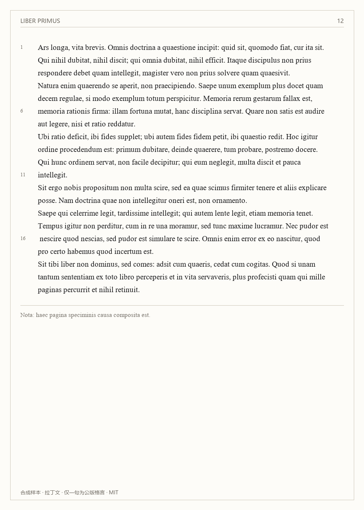
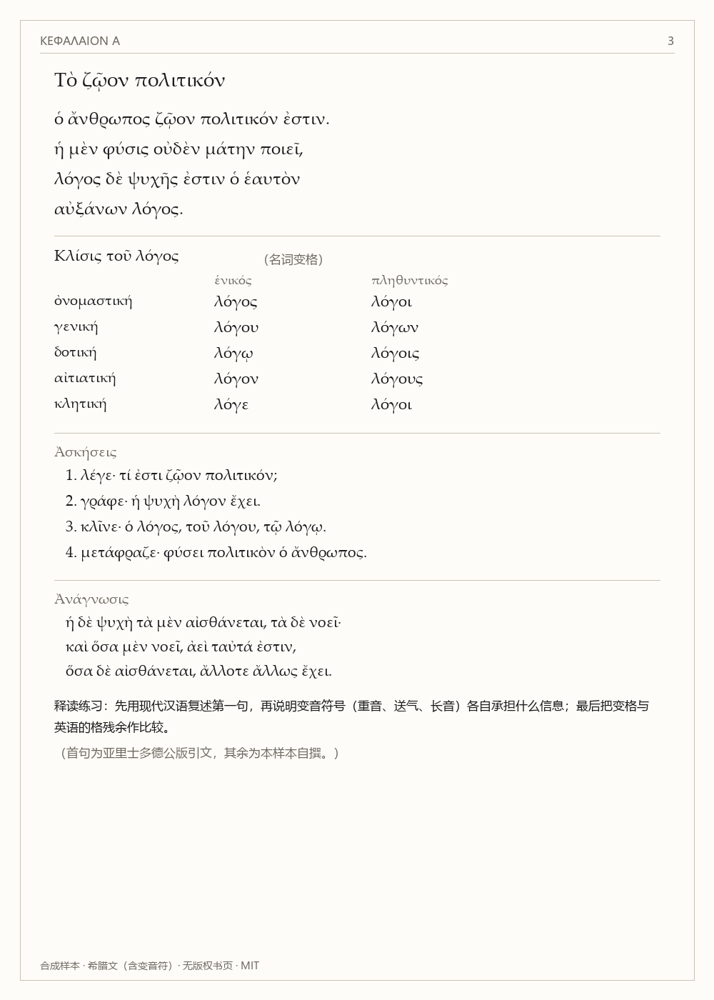

# socratic-tutor

**A citation-first Socratic tutor for scanned books.** Ask a question, get an answer that points at a page you can actually open — on a personal library of 27 GB of PDFs, including Chinese classical texts read vertically, Latin, and Greek.

[](https://pypi.org/project/classics-index/)
[](https://pypi.org/project/socratic-mcp/)
[](https://www.npmjs.com/package/dsh-socratic)
[](LICENSE)
[](https://github.com/Icefox12138/socratic-tutor/actions/workflows/ci.yml)



---

## Why this exists

Textbook chatbots answer from memory and cite nothing. For someone reading scanned editions — a punctuated `史記`, a Loeb volume, a 19th-century physics treatise — an answer you cannot check against the page is worthless, and a fabricated citation is worse than no citation.

So the constraint here is inverted: **every claim must carry a locator (`book p.N`) that resolves to a rendered page image**, and the retrieval layer is checked on whether that locator actually contains the text it claims. When the system cannot ground an answer, it is designed to say so rather than to improvise.

## What's in the box

| Component | What it is | Status |
|---|---|---|
| `plugin-socratic` | DSH plugin, 12 tools: cited retrieval, chapter lookup, page images, math check, session review | [npm `dsh-socratic@0.2.0`](https://www.npmjs.com/package/dsh-socratic) |
| `sidecar/` | FastAPI service: SQLite FTS5 + BGE-M3 embeddings + reranker + PyMuPDF page rendering | runs locally, not yet packaged |
| `packages/classics-index` | Volume/chapter (`卷 / 篇 / 回`) indexer for scanned Chinese books, built from OCR of running headers | [PyPI `classics-index@0.1.0`](https://pypi.org/project/classics-index/) |
| `packages/socratic-mcp` | The same capabilities as an MCP server, for any MCP host | [PyPI `socratic-mcp@0.1.0`](https://pypi.org/project/socratic-mcp/) |

## Five page types it handles

The tutor is built around the layouts that break naive PDF pipelines: display math, horizontal Chinese/English, vertical traditional Chinese, Latin, and polytonic Greek.

| | | |
|---|---|---|
|  |  |  |
| display math | horizontal zh/en | vertical traditional |
|  |  | |
| Latin with line numbers | Greek with breathings | |

These five images are **generated**, not scanned: see `eval/p3/make_sample_pages.py`. No copyrighted page appears anywhere in this repository.

## Quickstart

### Run the demo corpus (no books needed)

```bash
git clone https://github.com/Icefox12138/socratic-tutor.git && cd socratic-tutor
python eval/p3/make_demo_corpus.py          # builds a 5-page synthetic book + index

SOCRATIC_ROOT="$PWD/samples" \
SOCRATIC_DB="$PWD/samples/search.db" \
SOCRATIC_STATE_DB="$PWD/samples/state.db" \
SOCRATIC_BGE=0 \
(cd sidecar && python -m uvicorn app.main:app --port 8765)
```

Then open <http://127.0.0.1:8765/ui?q=极限> — search, citation, and page image, all on synthetic content.

### Install the published pieces

```bash
pip install classics-index          # chapter indexer
pip install socratic-mcp            # MCP server (needs a sidecar)
dsh plugin add dsh-socratic         # DSH plugin (needs a sidecar + a library)
```

### Add it to the DSH plugin market

DSH's Discover tab reads any index URL you give it. This repository hosts one:

```
https://raw.githubusercontent.com/Icefox12138/socratic-tutor/main/market/index.json
```

Paste that into **Settings → Plugins → Market indexes**, then install from Discover.

### Hook the MCP server into any host

```json
{
  "mcpServers": {
    "socratic": {
      "command": "python",
      "args": ["-m", "socratic_mcp.server"],
      "env": { "SOCRATIC_SIDECAR_URL": "http://127.0.0.1:8765" }
    }
  }
}
```

## Architecture

```
DSH GUI / any MCP host
        │  12 tools · HTTP (docs/SIDECAR-CONTRACT.md)
        ▼
   plugin-socratic  ──►  sidecar (FastAPI)
                          ├─ SQLite FTS5   (167k chunks, CJK bigrams)
                          ├─ BGE-M3 vectors (in-process matrix, no vector DB)
                          ├─ bge-reranker   (cross-encoder)
                          └─ PyMuPDF        (renders book p.N on demand)
        │
        └─ classics-index: OCR of running headers → 卷 / 篇 / 回 boundaries
```

The plugin and the sidecar talk over a documented contract, not over shared code — [`docs/SIDECAR-CONTRACT.md`](docs/SIDECAR-CONTRACT.md). Any implementation that satisfies it can replace the sidecar; `scripts/contract_check.py` makes that claim testable:

```bash
python scripts/contract_check.py --base http://127.0.0.1:8765 --query 极限
# 9 checks: openapi, endpoints, health, search, shape, page image, books, toc, chapter
```

## Status and limitations

This is a single-machine, single-student research project, published so the pieces can be reused. The honest scoreboard:

| Gate | Result |
|---|---|
| Citation resolves to a real page | **100%** (enforced server-side) |
| Page image renders | **100%** |
| Answer-key leakage (266 probes) | **0** |
| Deterministic session review accuracy | **86.7%** (23 held-out cases) |
| Monolingual retrieval recall | **0.82** — target 0.85, **not met** |
| Cross-lingual retrieval recall | **0.688** — target 0.70, **not met** |
| Human validation | **none yet** — every number above is machine-measured |

Known sharp edges: Greek OCR on degraded scans is unusable (the service falls back to page-image-only results), the sidecar needs a GPU to be fast, and there is no async ingestion API yet — building a library means running a script.

## Tests

```bash
cd sidecar                     && python -m unittest discover -s tests -p "test_*.py"   # 125
cd packages/classics-index     && python -m unittest discover -s tests -p "test_*.py" -t .   # 18
cd packages/socratic-mcp       && python -m unittest discover -s tests -p "test_*.py" -t .   # 6
cd plugin-socratic             && node --test test/plugin.test.mjs                     # 8
```

See [CHANGELOG.md](CHANGELOG.md) for what changed in each release, and
[CONTRIBUTING.md](CONTRIBUTING.md) before opening a pull request.

## Repository layout

```
plugin-socratic/     DSH plugin (tools, client cards, contract tests)
sidecar/             FastAPI service + minimal web UI
packages/            publishable Python packages (indexer, MCP server)
eval/                experiments and their reports (not shipped)
samples/             generated demo corpus
docs/                design notes, contracts, and AI-to-AI handoff logs
scripts/             contract probe, publish lint
```

`docs/` is unusual by design: much of it is **handoff documentation written between AI sessions** (different models, different agents), kept in-tree because it is the only durable memory of the project's decisions. Start at [`docs/README.md`](docs/README.md) if you want the reasoning, not just the result.

## Contributing

Issues and pull requests are welcome, especially:
- retrieval quality (the two unmet gates above),
- OCR of vertical/classical layouts,
- another sidecar implementation written against the contract.

Please note the licensing boundary: **code is MIT, books are not**. Never open a PR containing scanned pages, OCR dumps of copyrighted editions, or derived embeddings.

## License

Licensing is **per directory**, because the sidecar links PyMuPDF, which is AGPL-3.0:

| Path | License | Why |
|---|---|---|
| `packages/classics-index`, `packages/socratic-mcp`, `plugin-socratic/`, `eval/`, `market/` | [MIT](LICENSE) | no AGPL dependency |
| `sidecar/` | [AGPL-3.0-or-later](sidecar/LICENSE) | imports PyMuPDF (dual-licensed AGPL-3.0 / Artifex commercial) |

If you deploy the sidecar as a network service, AGPL-3.0 §13 applies: users interacting with it over a network must be offered its corresponding source. Running it privately for yourself is unaffected.

Third-party model weights (BGE-M3, bge-reranker) are **not** redistributed here; download them yourself and respect their licenses.

---

## 中文摘要

这是一个**引用优先**的苏格拉底式教学 Agent：回答必须给出 `书名 p.页码`，并能点开对应的页图核对；检索层会在服务端校验这个页码里确实包含所引文字，不满足就拒答而不是编造。

- 三个已发布件：`classics-index`、`socratic-mcp`（PyPI）、`dsh-socratic`（npm）；
- sidecar 是本地 FastAPI 服务，需要自备书库与 BGE 模型，尚未打包分发；
- 支持公式、横排中英、竖排繁体、拉丁、希腊五种版式；
- 检索召回尚未达标（单语 0.82 / 跨语言 0.688），也没有人工验证——所有指标都是机器测量的；
- 代码 MIT，**书库与 OCR 衍生物永不发布**。

`docs/` 里大量文档是不同 AI 会话之间的交接记录，保留在仓库里，因为它们是这个项目决策过程唯一的长期记忆。
