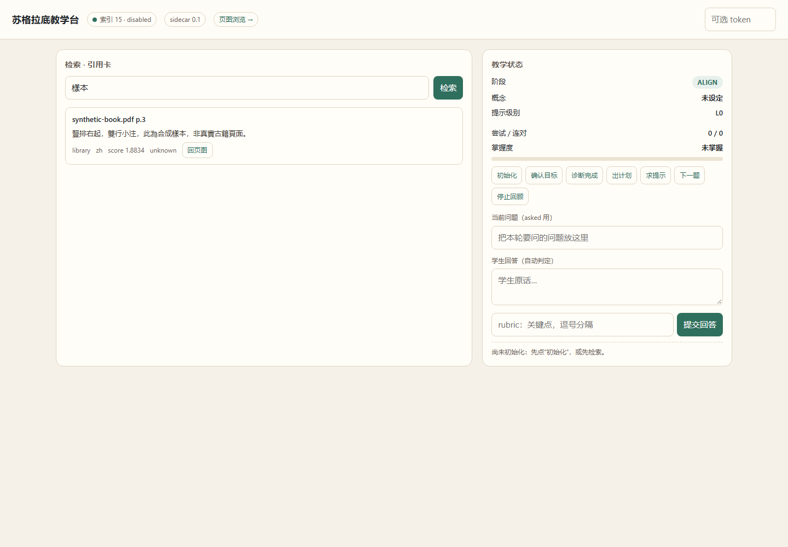

# P2-5 UI 报告（本会话标为 P2-4）

> 按 DESIGN 编号，UI 是 **P2-5**；上一轮为保持会话顺序标成了 P2-4。交付物同一份。
> **补充（2026-11-02）**：DSH 内嵌教学台已完成，见 [P2-5-embedded-ui.md](P2-5-embedded-ui.md)。

| 项 | 值 |
|---|---|
| 日期 | 2026-11-02 |
| 入口 | `http://127.0.0.1:8765/ui` |
| 位置 | `sidecar/ui/index.html`、`sidecar/app/main.py` `/ui` |
| 结论 | **独立教学台可用；DSH 内嵌也已完成** |
| 后续状态 | composer 面板 + turnTail 引用卡 + K5 希腊页图；见 `P2-5-embedded-ui.md` |

## 1. 功能

| 区块 | 内容 |
|---|---|
| 检索 | 输入问题 → `/v1/search`；每条结果一张引用卡 |
| 引用卡 | locator（书 + 页）、snippet、source/lang/score/tier、**回页图** |
| 页图 | `dialog` 内嵌 `/v1/pages` PNG，点背景/关闭退出 |
| 教学状态 | 阶段、概念、提示级别、尝试/连对、掌握度条 |
| 提示阶梯 | L0–L5 六个 chip，高亮当前级别 |
| 状态操作 | 初始化、确认目标、诊断完成、出计划、求提示、下一题、停止回顾 |
| 判定 | 当前问题 + 学生回答 + rubric → `/v1/state/step` 自动判定 |
| Token | 顶部可选 `X-Sidecar-Token`，存 localStorage |
| 深链 | `?session=p24demo&q=导数` 直接复现某个会话/检索 |

## 2. 实测

- `/ui` 返回 200，11.7 KB HTML；
- 首屏健康：`索引 167192 · ready`；
- 检索“导数”返回 6 张引用卡，`bge+rerank`，耗时 ~1.0 s（预热）；
- 状态：`ADVANCE / 导数 / L0 / 1-1 / 已掌握`；
- 截图：`screenshot-demo2.png`（1440×1000）。

## 3. 交互

- 检索：`/v1/search?view=student&limit=6`；
- 回页图：`citation.page_image` 直接给 ``；
- 初始化：`POST /v1/state/init`；
- 生命周期按钮：`POST /v1/state/step`；
- 回答：`text + rubric` 交给 sidecar 判定，返回 `evaluation/mastery`；
- 任何 4xx/5xx 显示在日志区，不静默。

## 4. 边界

- **不是 DSH 内嵌 UI**：是 sidecar 的独立页面；DSH 对话里仍只有文本工具结果；
- 没有聊天流；教学对话仍在 DSH，UI 用于检索/状态/页图/演示；
- 没有引用卡点击回 DSH 会话，也没有会话列表；
- 没有移动端专门优化（CSS 900px 断点已做单列）；
- token 只是简单头，不是登录。

## 5. 测试

- `/ui` HTTP 200 + 包含“苏格拉底教学台/引用卡”；
- 检索 6 条，引用卡 locator 正确；
- 状态初始化/推进/回答；
- Edge headless 截图两张（空态 + 有状态）；未做自动化点击/控制台断言。

## 6. 下一步

- P2-5：100 段对话评估；
- 或做 DSH client plugin，把引用卡嵌进对话流（需要构建 `dsh.client` bundle，工作量大）。
