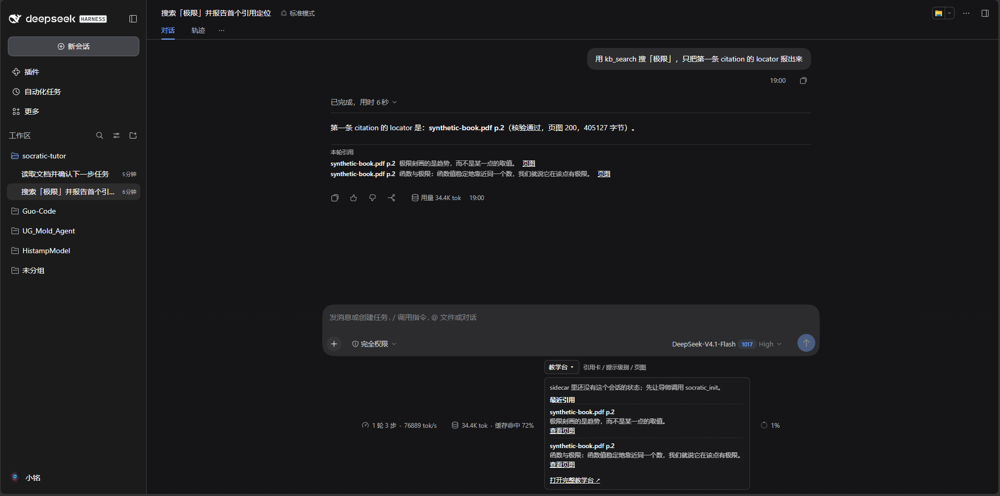
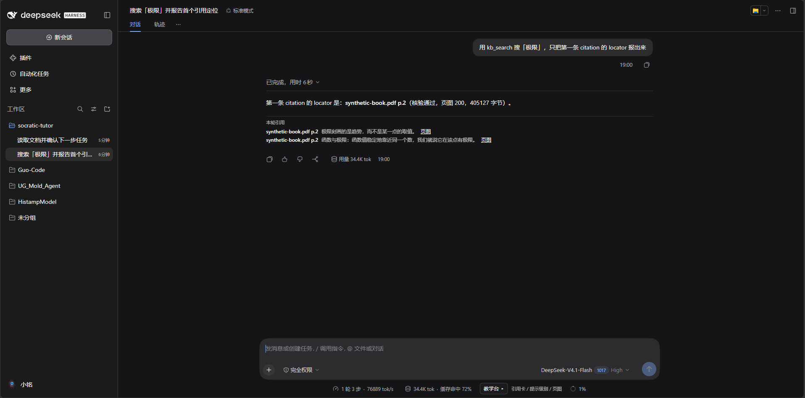
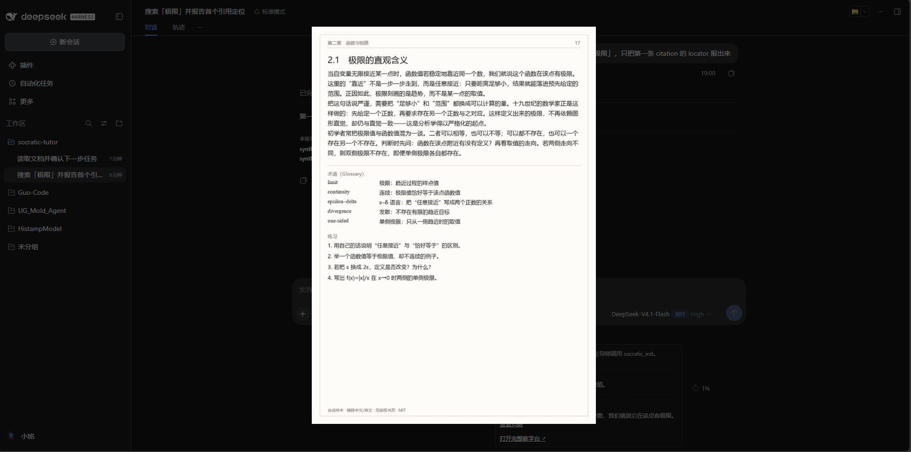

# P2-5 DSH 内嵌 UI 报告

| 项 | 值 |
|---|---|
| 日期 | 2026-11-02 |
| 入口 | DSH Web GUI 的 composer dock 下方 |
| 位置 | `plugin-socratic/client.js`、`package.json` `dsh.client` |
| 结论 | **内嵌教学台已渲染**；需重启/刷新 DSH Web 才能加载 |



## 1. 实现

- `plugin-socratic` 增加 `dsh.client`（`platform: web`）与 `exports["./client"]`；
- `client.js` 是 lazy-CJS factory：`window.__ModuleLoader__.load({ id, factory(require) })`；
- 注册 slot `conversation.composer.dock`（list，id `socratic-panel`）；
- 组件用 `React.createElement`，不引入 Harness Client 包；
- 折叠按钮显示 `教学台 · 阶段`；展开显示：
  - 阶段 / 概念 / 提示级别 / 尝试·连对 / 掌握度；
  - 最近引用（locator + snippet + 页图）；
  - “打开完整教学台”链接到 `/ui?session=…`。

## 2. 后端配套

- `kb_search` 带 `session_id`，sidecar 把每次结果写入 `citations` 表；
- `GET /v1/citations/{session_id}` 返回最近引用；
- CORS 只允许 `http://127.0.0.1:*` / `http://localhost:*`（`allow_origin_regex`），不再 `*`；
- 引用页图直接用 sidecar `/v1/pages` 地址。

## 3. 验证

- 临时 `web` profile 服务器（64839）的 boot graph 包含：
  `{"id":"dsh-socratic","url":"plugins/??dsh-socratic/client.js..."}`；
- CDP dump：`教学台=True`、`引用卡=True`、`最近引用=True`；
- 截图中面板显示 `ALIGN / 未设定 / L0 / 0-0 / 未掌握`；
- 让 GUI agent 调 `kb_search` 后，面板出现 `数学\其他\随机过程... p.122` 等引用和“查看页图”；
- 侧边栏“新会话”创建后 composer dock 渲染，说明 slot 挂载正确。

## 4. 安装/生效

```powershell
cd D:\Guo-Code\socratic-tutor
dsh plugin --profile tutor add "link:D:/Guo-Code/socratic-tutor/plugin-socratic"
dsh plugin --profile web add "link:D:/Guo-Code/socratic-tutor/plugin-socratic"
```

- `web` profile 是 GUI 用的 profile；已加入 0.2.0；
- **运行中的 GUI 不会自动热加载新 client entry**：需要刷新页面；仍不出现则重启 `dsh web`；
- 本次验证用临时 64839 服务器，未重启用户 GUI 64838。

## 5. 限制

- 只是 **composer dock 面板**，不是每条 assistant 消息内嵌引用卡；
- 展开状态不持久化；折叠时每 5 s 不轮询；
- 依赖 sidecar 在 `127.0.0.1:8765`；可用 `localStorage.socratic_sidecar` 覆盖；
- 没有 token 输入；sidecar 开 token 时需在页面环境注入；
- 引用列表是“最近 8 条”，不是按消息归属；
- 页图是全屏 overlay，不是可拖拽窗口。

## 6. 按消息归属的引用卡（补做）



- 新 slot：`conversation.chat.turnTail`（list）；
- `kb_search` 把 `exec.agent.phase.turn/step` 与 `callId` 传给 sidecar；
- `citations` 表新增 `turn/step/call_id`；
- `GET /v1/citations/{session}?turn=N` 按轮过滤；
- turnTail 组件拿到的是 **TurnRecord 对象**，取 `props.turn.turn` 的数字；
- 每个 assistant 回合尾部渲染“本轮引用”：locator + snippet + 页图；
- 实测：`kb_search` 后该轮出现 3 条引用（p.36 / p.92 / p.122），不再混到全局面板。

边界：卡片在**回合尾部**，不是 assistant 气泡内部；同一回合多个 tool call 的引用会合并显示。

## 7. K5 希腊：页图引用

K5 希腊 OCR 不可用（CER 0.71–0.94），引用卡改为：

- `citations.lang === 'greek'` 时不展示 snippet；
- 显示“希腊原文：OCR 不可用，仅页图”；
- 直接渲染 `page_image` 缩略图，点击全屏；
- 仍保留 locator（书名 + p.N）。

这样学生看到的是原书页图，而不是错误转写的希腊文。

实测（临时 64839 + Edge CDP）：

- 打开 `session-a1f5716a...`，该轮有 2 条 `lang=greek` 引用；
- 页面出现“希腊原文：OCR 不可用，仅页图”+ 2 张缩略图；
- 点击第 2 张，打开 `/v1/pages?...page=147` 全屏 overlay；
- 截图：`plugin-socratic/dsh-page-image.png`。



> 图为**合成样本页**（`samples/` 演示语料）——原 K5 希腊页图因版权在开源前被替换，结论不变。

## 8. 下一步

- 把引用卡挂到 `conversation.chat.node`（按消息归属）；
- 面板状态持久化到 slot store（当前组件本地 state）；
- 加 token 配置与 sidecar 预加载。
